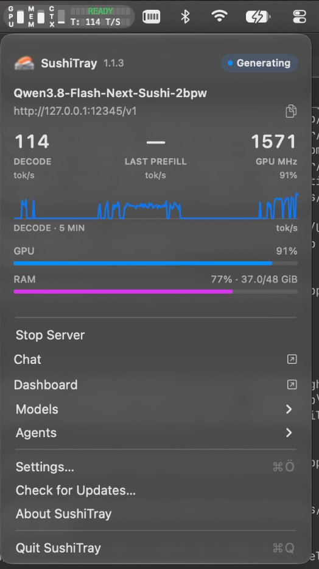
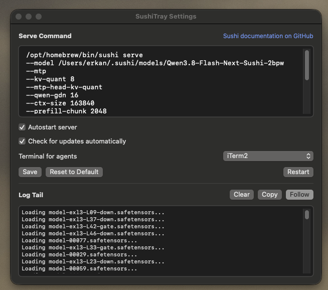

# SushiTray

SushiTray runs and monitors a local
[Sushi](https://github.com/beamivalice/sushi) AI server from the macOS menu bar.

<p align="center">
  
</p>

<p align="center">
  
  
</p>

## Features

- Start and stop `sushi serve` from the menu bar.
- See model status, prefill and decode speeds, and GPU, memory, and context
  usage.
- Open Chat or Dashboard, or copy the OpenAI-compatible API URL.
- Browse local models and copy available model pack update commands.
- Launch coding agents in your preferred terminal.
- Edit the serve command, configure autostart, and view live logs.
- Automatically check for Sushi CLI and SushiTray updates at launch.

## Install

### Homebrew (recommended)

Apple Silicon, macOS 13+:

```bash
brew tap derkan/tap
brew trust derkan/tap          # required once (Homebrew third-party tap policy)
brew install --cask sushitray
```

Upgrade later with:

```bash
brew update
brew upgrade --cask sushitray
```

You also need the sushi CLI:

```bash
brew install beamivalice/tap/sushi
```

Then open **SushiTray** from Spotlight / Launchpad (menu bar only — no Dock
icon).

> **Gatekeeper:** builds are not notarized yet. If macOS blocks the app:
>
> ```bash
> xattr -cr /Applications/SushiTray.app
> ```

Uninstall:

```bash
brew uninstall --cask sushitray
```

### Build from source

```bash
git clone https://github.com/derkan/SushiTray.git
cd SushiTray
make run-release
```

## Requirements

- macOS 13.0+ (Ventura or later)
- Apple Silicon (arm64)
- [sushi](https://github.com/beamivalice/sushi) **1.5.0 or newer** on `PATH`
  (`brew install beamivalice/tap/sushi`)
- To build from source: Xcode 15+ command line tools

## Usage

1. Open **SushiTray** from Spotlight or Launchpad, then click its menu bar item.
2. Open **Settings** to point the serve command at your model. Autostart is on
   by default. Use **Start Server** or **Stop Server** to control it manually.
3. When the server is ready, open **Chat** or **Dashboard**, or click the API
   URL in the menu to copy it for an OpenAI-compatible client.
4. Choose **Models** to browse available models. With the server stopped,
   SushiTray uses the last model list or looks for models on disk.
5. Choose **Agents**, select an agent, and pick a working folder. Cancel the
   folder picker to use your home directory.

**Reading metrics.** Prefill measures prompt processing. Decode measures
generation in tokens per second. Hover over **CTX** for context usage when one
session is active and its context limit is known.

**Troubleshooting.** Check the live logs in **Settings** if the server fails to
start or load a model. The default log path is `~/.sushi/logs/sushi.log`.
SushiTray controls the server process it launches.

**Updates.** At launch, SushiTray checks for updates to both the Sushi CLI and
SushiTray. If an update is available, choose **Update** to install it. Startup
checks are on by default and can be turned off in **Settings**. Use **Check for
Updates…** to check manually. **About SushiTray** shows both installed versions.

### Default serve command

Editable in Settings:

```text
sushi serve --model ~/.sushi/models/Qwen3.8-Flash-Next-Sushi-2bpw \
  --mtp --kv-quant 8 --mtp-head-kv-quant --qwen-gdn 16 --ctx-size 131072 \
  --max-tokens 32000 --prefix-cache-disk 20GB --prefix-cache-entries 1 \
  --prefix-cache-mem 1GB --temp 1
```

Example for a 48 GB Mac with Sushi-2bpw; the app requires Sushi ≥ 1.5.0. On 32
GB use `--ssd-budget-gb` streaming; on 64 GB prefer Sushi-2.6bpw with
`--ctx-size 250000`. See
[sushi usage](https://github.com/beamivalice/sushi/blob/main/docs/usage.md).

On a 48 GB Mac running Sushi-2bpw, consider the optional BF16 n-gram table for
a small quality gain. It uses about 66 GiB more SSD space and leaves GPU memory
usage the same. Follow the
[model card's n-gram table instructions](https://huggingface.co/beamster/Qwen3.8-Flash-Next-Sushi-2bpw#choosing-the-n-gram-table)
to swap tables.

Default listen address is sushi’s default (`127.0.0.1:12345`) unless you add
`--host` / `--port`.

## Build & release (maintainers)

```bash
make icons          # from assets/icon.svg (needs ImageMagick `magick`)
make run-release    # build and launch the release app
make dist           # → dist/SushiTray-<version>.zip + sha256
```

| Target                       | Description                                               |
| ---------------------------- | --------------------------------------------------------- |
| `make run` / `run-release`   | Build, bundle, launch                                     |
| `make dist`                  | Release zip for GitHub / Homebrew                         |
| `make test`                  | Regression tests                                          |
| `make release VERSION=X.Y.Z` | Test, build, version commit, tag, push and publish via CI |
| `make icons`                 | Regenerate icons                                          |
| `make clean`                 | Remove build products                                     |

Publishing a release (Python 3 and Git push access required):

1. Write and commit `release-notes/X.Y.Z.md` with the changes and compatibility
   requirements.
2. Commit other tracked changes, then run:

```bash
make release VERSION=1.1.0
```

The command validates the version, increments the app build number, runs tests,
builds the signed ZIP, commits the version bump, and atomically pushes the
branch and annotated tag to `origin`. The default destination branch is `main`
(`RELEASE_BRANCH` overrides it). Uncommitted tracked changes are rejected; use a
clean worktree if you have unrelated edits.

GitHub Actions (`.github/workflows/release.yml`) tests and builds the tagged
commit, then publishes the ZIP with the committed release notes, installation
instructions and checksum. It updates the Homebrew cask using the
`HOMEBREW_TAP_DEPLOY_KEY` Actions secret, which holds a write deploy key for
[derkan/homebrew-tap](https://github.com/derkan/homebrew-tap).

Open in Xcode: `make xcode`

## Project layout

```text
SushiTray/
├── Package.swift
├── Makefile
├── packaging/homebrew/sushitray.rb   # cask template
├── assets/icon.svg                  # source logo
└── SushiTray/                        # sources + Info.plist + icons
```

## Related

### Agent skill

[`skills/sushi-local-ai/SKILL.md`](skills/sushi-local-ai/SKILL.md) provides a
portable skill for choosing Sushi models from Mac hardware, generating serve
parameters, checking model-specific optimizations, and installing/configuring
SushiTray. It includes a read-only hardware probe and dated source references.
Copy the entire `sushi-local-ai` folder into your agent's supported skill
directory (for Codex: `~/.codex/skills/`), then invoke `$sushi-local-ai` where
supported. No model weights are bundled.

- [sushi](https://github.com/beamivalice/sushi) — local MLX AI server
- Homebrew: `derkan/tap` (this app), `beamivalice/tap/sushi` (CLI)

## License

[Apache License 2.0](LICENSE)
